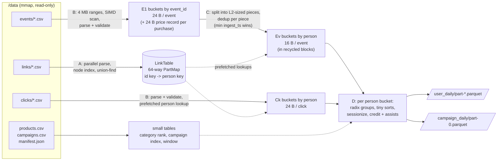
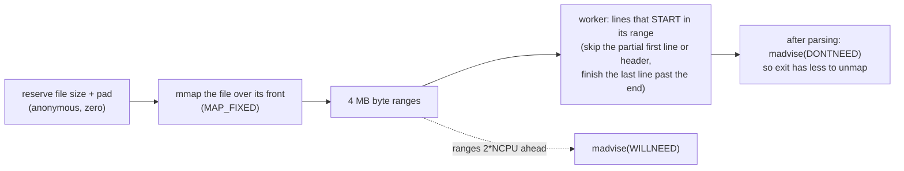
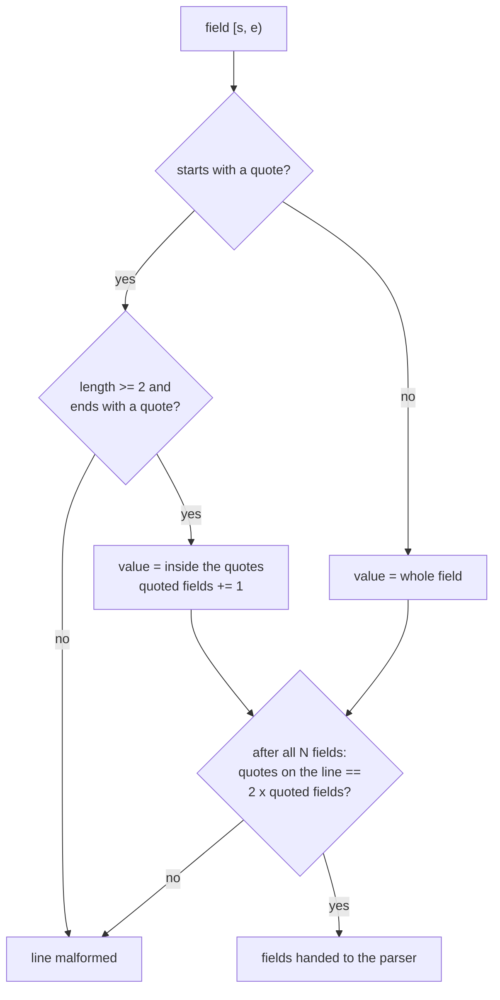
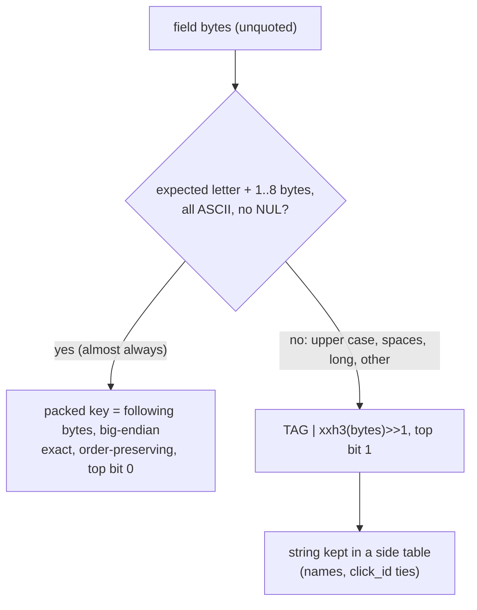
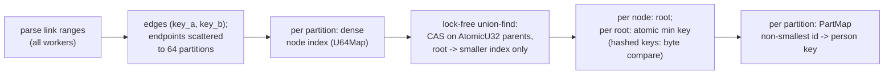
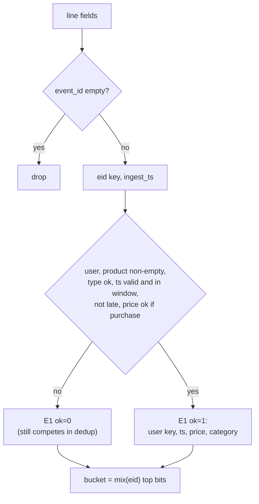
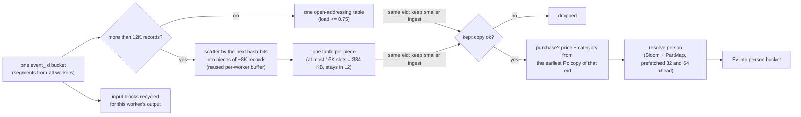
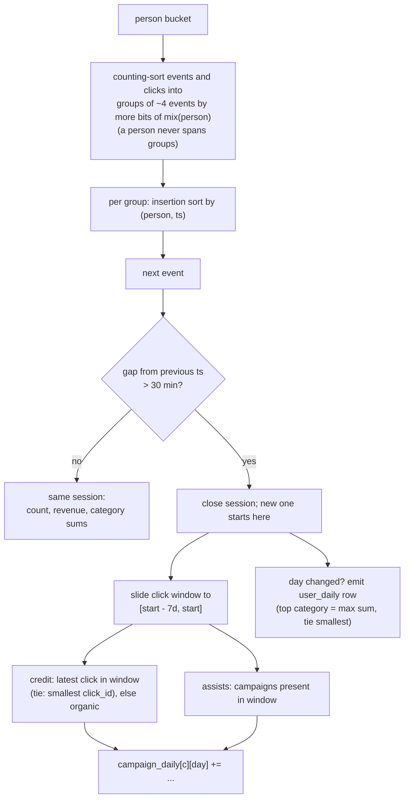

# Architecture (v3.11)

How `src/` turns the CSV logs in `/data` into the two Parquet tables. The spec is `rules.md`; this page explains the data flow and the reasons for each design choice. Scores, measurements and experiments are tracked in [PROGRESS.md](PROGRESS.md).

| File | Role |
| --- | --- |
| `src/main.rs` | Orchestration, stages 1 to 3, sessionization, output assembly |
| `src/links.rs` | Linked IDs: parallel node index and lock-free union-find |
| `src/scan.rs` | Input mapping, SIMD CSV scanner, branch-free dialect check |
| `src/keys.rs` | ID keys (SWAR), timestamps (date cache + SWAR), hash tables, prefetch |
| `src/mem.rs` | Block arena, append-only buckets, block recycling |
| `src/out.rs` | Parquet writers |

## 1. Data flow

Stages run one after another, except links, which overlap stage B: clicks need links, so click ranges come last and wait for them. Each stage is a `std::thread::scope` with `NCPU` workers pulling work items from an atomic counter:

| Stage | Work items |
| --- | --- |
| A (links) | link file ranges, then partitions; runs on 3 threads of its own while stage B parses events |
| B (parse) | 4 MB input ranges |
| C (dedup) | event_id buckets |
| D (sessions) | person buckets, biggest first so a whale person's bucket does not finish last |

## 2. Reading input without copies

Every input file is mapped read-only on top of a slightly larger anonymous zero region. The scanner may then read up to 64 bytes past the last line with no bounds checks, and never fault.

Ranges are byte offsets, not line-aligned, so nothing scans the file before work starts. The boundary rule was verified against the dev answer with 997-byte and 64-byte ranges.

## 3. Scanner and dialect check

`scan::for_each_record` turns each 64-byte block into three bitmasks: comma, quote and newline. It uses AVX2 on the scorer and NEON on ARM. For each line it records the comma positions and **counts** the quotes. The dialect check is branch-free per field:

Any quote that is not the first or last byte of a field breaks the count, so the count check replaces a per-quote position check. Randomized tests compare the scanner to a plain reference splitter.

## 4. Keys instead of strings

Generator IDs are one letter plus at most 8 base-36 characters: `u8nj7nrj5`, `e42huhoug`, `k9pbmgz1e`. `pkey_p(field, letter)` checks the expected letter (`e` for events, `u` for users, `k` for clicks), loads the next 8 bytes once, masks them to the ID's length, and byte-swaps them. The result is the key: exact, never 0, top bit clear, and among IDs with the same letter integer order equals byte order.

* Names come back by decoding the key, so records carry no string pointers.
* Equality and click_id tie-breaks are integer compares. Only hashed keys, which are rare, fall back to comparing bytes.
* A **person key** is the key of the person's byte-wise smallest ID.

## 5. Stage A: links, fully parallel

All five steps run on every worker. They take about 55 ms on 20M events, against 180 ms for the serial v2 version.

Hash tables take their slot bits from a different part of the hash than the partition and bucket choices. Otherwise every key of one partition would land in 1/64 of the table; v3 hit exactly that bug at first, and links took 4.4 s.

## 6. Stage B: parse

Timestamps:
* `ts_p` looks the `YYYY-MM-DD` part up in a 64-entry date cache, since a dataset has a few dozen distinct dates.
* It validates and converts `HH:MM:SS` with one 8-byte SWAR check.
* It parses F3 epoch digits 8 at a time (Lemire's method).
* Randomized tests compare it to the plain reference parser.

Record layouts:

| Record | Bytes | Fields |
| --- | --- | --- |
| `E1` (event before dedup) | 24 | `eid`, `user` (bit 55 flags a valid purchase), `w = ts_rel<<33 \| ingest_s<<1 \| ok` |
| `Pc` (valid purchase) | 24 | `eid`, `pc = price<<9 \| category`, `ing` (its copy's ingest) |
| `Ev` (surviving event) | 16 | `person`, `w2 = ts_rel<<33 \| price<<9 \| category` |
| `Ck` (valid click) | 24 | `person`, `w1 = ts_rel<<24 \| campaign`, `ckey` |

Bit 55 of a key is always 0: packed keys are ASCII bytes, and hashed keys clear it. `ingest_s` is whole seconds (F1 has no fractions) offset into 32 bits. Purchases are about 3% of events, so price and category travel in a side record keyed by event id instead of widening every event.

`ts_rel` is measured from `window_start - 7 days`, so events and clicks share one 31-bit clock.

Clicks are parsed into a small per-range buffer first. Their person lookups then run with prefetches issued 16 clicks ahead.

Records go into 512 event_id buckets through **write-combining** buffers (`mem::WcBuckets`). Each bucket fills a group of whole cache lines in a small hot buffer (8 events of 24 B = 192 B, or 4 stage-2 outputs of 16 B = 64 B), and full groups go to the bucket's block with non-temporal stores. Scattering straight into a thousand buckets missed the cache on nearly every store; the push cost per line roughly tracks the number of buckets (5.5 ns at 64, about 15 ns at 1024, 20 to 29 ns at 4096).

## 7. Stage C: dedup

Dedup happens before validation, as the rules require: an invalid earliest copy still wins its eid and then drops the event.

At 60M events a 512-way bucket holds about 125K records. One table for all of them would be 6 MB per worker, so nearly every insert would miss both L2 (1 MB per core on the scorer) and the shared L3. Splitting first costs one sequential pass and keeps every insert in L2.

## 8. Stage D: sessions, credit and assists

## 9. Output

* `user_daily` is written as one file per worker, in parallel, as each worker finishes its buckets. Pages of up to 128K rows are encoded into one reused buffer and streamed through a 1 MB writer, so no file is assembled whole in memory.
* `campaign_daily` is one file.
* Encoding is plain and uncompressed with no statistics. `day` is `INT32 (DATE)`.

## 10. Correctness checks

| Check | Command |
| --- | --- |
| Unit tests (fast parsers and scanner vs reference) | `cargo test --release` |
| 36 edge-case fixtures | `python3 scripts/run_fixtures.py fixtures -- scripts/dev_run.sh` |
| 1M dev set vs published answer | `scripts/dev_run.sh dev out && python3 scripts/compare.py out dev-answer` |
| Range-boundary stress | the dev set with `FM_CHUNK=997` and `FM_CHUNK=64` |
| Dedup split path | the dev set with `FM_SUBMAX=100` (every bucket split into dozens of pieces) and the fixtures with `FM_SUBMAX=1` |
| Scorer platform | all of the above with `IMAGE=...:amd64 PLATFORM=linux/amd64` |
| Regression on 20M | output must equal the previous version's, row for row |
