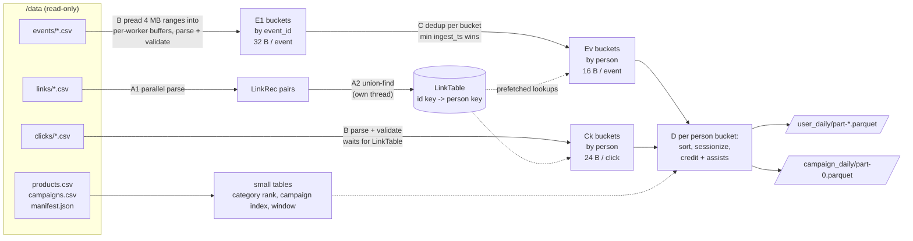
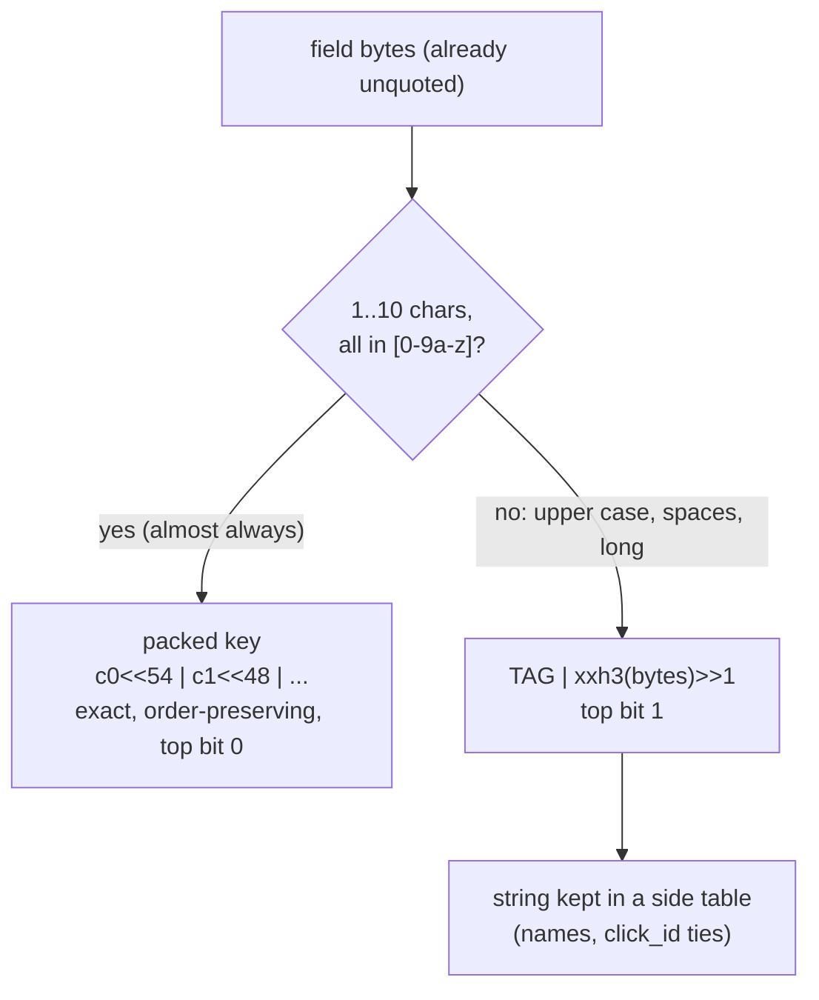
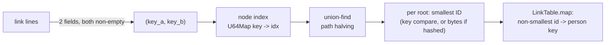
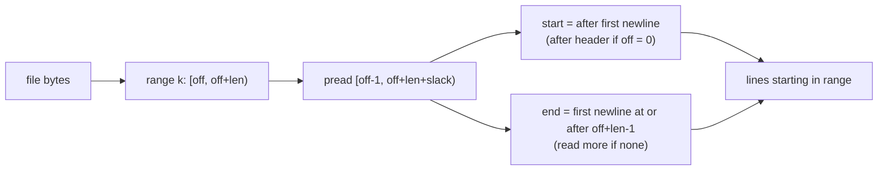
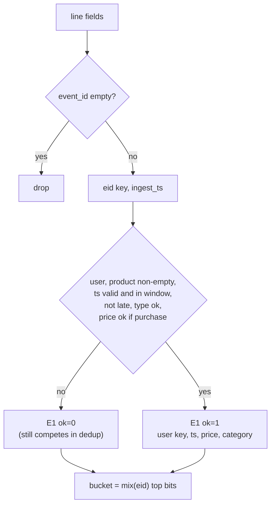
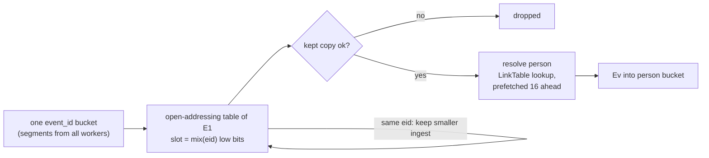
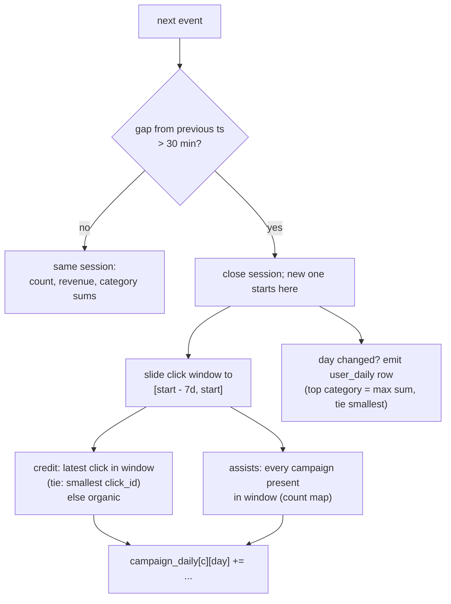

# Architecture

How `src/` turns the CSV logs in `/data` into the two Parquet tables. The spec is `rules.md`; this page explains the data flow and the reasons for each design choice. Progress, scores and experiments are tracked in [PROGRESS.md](PROGRESS.md).

| File | Role |
| --- | --- |
| `src/main.rs` | Orchestration, the five stages, link union-find, sessionization |
| `src/scan.rs` | SIMD CSV structural scanner and the dialect check |
| `src/keys.rs` | ID keys, timestamps, prices, the `U64Map` hash table, prefetch |
| `src/mem.rs` | Block arena and append-only buckets |
| `src/out.rs` | Parquet writers |

## 1. Data flow

Each event crosses memory three times: once from the CSV into an event_id bucket (stage B), once from there into a person bucket (stage C), and once into a sort buffer (stage D). Clicks skip the middle step because they need no dedup.

## 2. Timeline and threading

```mermaid
gantt
    title One run (20M events, 8 vCPUs, local best)
    dateFormat X
    axisFormat %L ms
    section main
    map files, small tables      :0, 10
    links parse (8 threads)      :10, 20
    section link thread
    union-find + LinkTable       :20, 200
    section 8 workers
    stage B events               :20, 450
    stage B clicks (needs links) :450, 560
    stage C dedup + scatter      :560, 700
    stage D sessions             :700, 840
    write parquet                :840, 925
```

* Every stage is one `std::thread::scope` with `NCPU` workers pulling work items from an atomic counter. Work items are input chunks (stage B) or buckets (stages C and D), so a big whale bucket never blocks the others.
* The union-find is serial, so it runs on its own thread while the workers parse events, which do not need it. Click chunks come last in the task list and block on a `OnceLock` until the link table is ready.

## 3. Keys instead of strings

Generator IDs are a letter plus base 36: `u8nj7nrj5`, `e42huhoug`, `k9pbmgz1e`. `id_key` packs any 1 to 10 characters from `[0-9a-z]` into an exact 60-bit integer, 6 bits per character and left-aligned. Integer order then equals byte order.

* Names come back by decoding the key, so records carry no string pointers.
* Equality and click_id tie-breaks are integer compares. Only hashed keys, which are rare, fall back to comparing the real bytes.
* A **person key** is the key of the person's byte-wise smallest ID. `LinkTable` maps every *other* linked ID to it. An ID that maps to nothing is its own person.

## 4. Stage A: links

## 5. Stage B: parse

Events and clicks are cut into 4 MB byte ranges, not line-aligned. A worker `pread`s its range, plus a little slack, into a reused buffer and parses exactly the lines that **start** inside the range:

* the header line when the range begins at 0
* the partial line at the front, which belongs to the previous range, is skipped
* the line that runs past the end is finished from the slack, read further if needed

Reading into a warm buffer avoids the page faults of touching a fresh `mmap` page by page. Those faults cost as much as parsing itself. The next ranges are announced with `posix_fadvise(WILLNEED)` so a cold disk streams ahead. Links are small and still use `mmap`.

`scan::for_each_record` loads 64 bytes at a time and builds three bitmasks (comma, quote, newline) with AVX2 on the scorer (NEON on ARM). Each line's field boundaries come straight from the mask bits, and the dialect check runs on those positions:

* exactly N fields
* a quote only as the first and last byte of a field
* everything else malformed

A line with no quote at all takes a fast path straight from the comma positions. `\r` is ordinary data because only `\n` is looked for.

Record layouts, packed so every pass moves as few bytes as possible:

| Record | Bytes | Fields |
| --- | --- | --- |
| `E1` (event before dedup) | 32 | `eid`, `user`, `w2 = ts_rel<<33 \| price<<9 \| category`, `ing = ingest<<1 \| ok` |
| `Ev` (surviving event) | 16 | `person`, `w2` |
| `Ck` (valid click) | 24 | `person`, `w1 = ts_rel<<24 \| campaign`, `ckey` |

`ts_rel` is measured from `window_start - 7 days`, so both events and clicks fit in 31 bits.

Buckets are `mem::Bkt`: chains of 16 KiB blocks from a lock-free bump arena. Nothing is reallocated or freed during the run, which removed the realloc copying and mmap churn that dominated v1.

## 6. Stage C: dedup

Dedup happens before validation, as the rules require: an invalid earliest copy still wins its eid and then drops the event.

## 7. Stage D: sessions, credit and assists

Per person bucket: gather and sort `Ev` by (person, ts) and `Ck` by (person, ts), then walk each person once:

* The click window is two pointers over the person's sorted clicks, plus a per-campaign count and a present-list. Assists cost O(campaigns in window) per session.
* Campaign stats accumulate in a per-worker dense array `[campaign][day][4]`, summed at the end. A row is written when credited sessions > 0 or assisted sessions > 0.

## 8. Output

* `user_daily` is written as one file per worker, in parallel. `campaign_daily` is a single file.
* Encoding is plain and uncompressed with no statistics, the cheapest Parquet to produce. `day` is `INT32 (DATE)`.

## 9. Correctness checks

| Check | Command |
| --- | --- |
| 36 edge-case fixtures | `python3 scripts/run_fixtures.py fixtures -- scripts/dev_run.sh` |
| 1M dev set vs published answer | `scripts/dev_run.sh dev out && python3 scripts/compare.py out dev-answer` |
| Same on the scorer platform | `IMAGE=...:amd64 PLATFORM=linux/amd64` with the commands above |
| Regression on 20M | new output must equal the previous version's, row for row |
