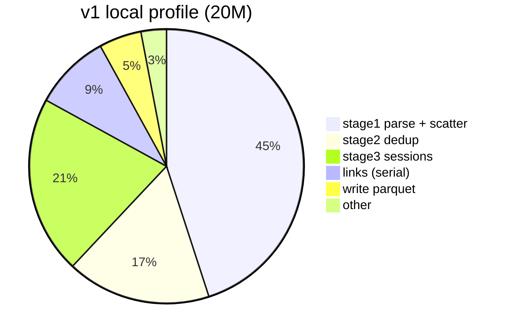
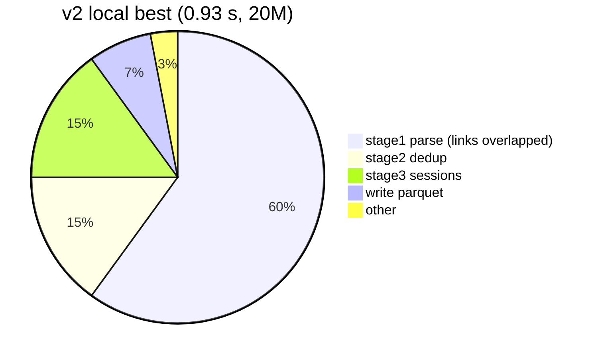
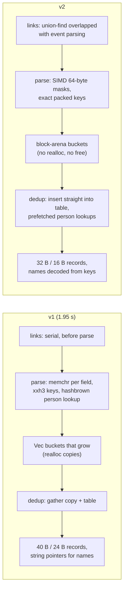

# Progress log

Goal: the top of the Shopping Sessions leaderboard. At the time of the first submission (Sat morning) the fastest practice times were 0.31 s, with the pack around 1.0 to 1.5 s. Final cutoff: Sun 10:00 AM CST.

## Scoreboard

| Version | Commit | Practice score (20M, scorer) | Local best, 20M, data in RAM | Correct |
| --- | --- | --- | --- | --- |
| v1 | `4a02f9d` | **1.95 s** | 1.80 s | 36/36 fixtures, dev MATCH |
| v2 | `88d363d` | not submitted | 0.93 s | 36/36 fixtures + dev MATCH on arm64 and amd64 (AVX2); 20M identical to v1 |
| v2.1 | see git log | not submitted yet | ~13% faster than v2 in an interleaved A/B | same, plus dev MATCH with 997-byte and 64-byte chunks (boundary stress) |

Local timings come from a Docker VM on an 8-core Apple-silicon Mac, with the data in `/dev/shm`. The Mac is often loaded, so one run can vary 2 to 3x. Only best-of-N is meaningful, and only the board counts.

## Where the time goes

v2 profile (perf, CPU samples):
* Stage 1 user code is 47%: the scan loop 22%, event field parsing 17%, click parsing 8%.
* The kernel takes about 25%: page zeroing 8%, page-allocator lock contention 6%, page migration 4.5%.
* Stage 2 is 9%, and the stage 3 sort and walk 8%.

## v1 -> v2: what changed and why

## Measurements behind v2.1

Single-thread scanner throughput on memory that is already touched, on one 256 MB event file (best of 5):

| Step | Throughput |
| --- | --- |
| SIMD masks only | 17 GB/s |
| + cut lines and fields | 2.1 GB/s |
| + two ID keys | 1.55 GB/s |
| + two timestamps | 1.2 to 1.4 GB/s |
| (memchr for newlines, reference) | 29 to 35 GB/s |

Inside the pipeline, the same field-splitting step ran at about half that speed. The difference was first-touch page faults on the `mmap`ed input. Hence the switch to `pread`.

## Experiments

| Idea | Result | Kept? |
| --- | --- | --- |
| Block arena instead of growing `Vec` buckets | Less copying and memory churn; parse no longer dominated by reallocation | yes |
| Single-pass SWAR line splitter vs memchr per field | 0.047 s vs 0.056 s per 64 MB (single thread) | superseded by the SIMD scanner |
| `MADV_POPULATE_READ` per input chunk | No measurable change | no |
| Huge pages on the arena (`MADV_HUGEPAGE`) | No change locally, because the VM's THP is already `always`. Scorer setting unknown | env switch `FM_THP`, off |
| Exact packed ID keys | Removes hashing, string pointers and collision risk | yes |
| Union-find on its own thread | Takes about 0.18 s of serial work off the critical path | yes |
| 16-byte person records | Halves stage 3 traffic | yes |
| `pread` ranges into reused buffers instead of `mmap` | ~13% faster end to end in an interleaved A/B; stage 1 no longer pays input page faults | yes |
| Fast path in field split for quote-free lines | Skips per-field quote checks for most lines | yes |

## Backlog (ordered by expected gain)

1. Stage 1 per-line cost: cheaper timestamp parse (SWAR digit checks), SWAR ID-key packing.
2. Kernel page-fault cost: reuse stage 1 blocks for stage 2 output, and pre-fault the arena in parallel.
3. Stage 3: radix sort, or group by a dense person index, instead of comparison sort.
4. Thread count above `NCPU` to hide page faults; tune bucket counts for 60M.
5. Parquet: write `user_id` without per-row allocation.
