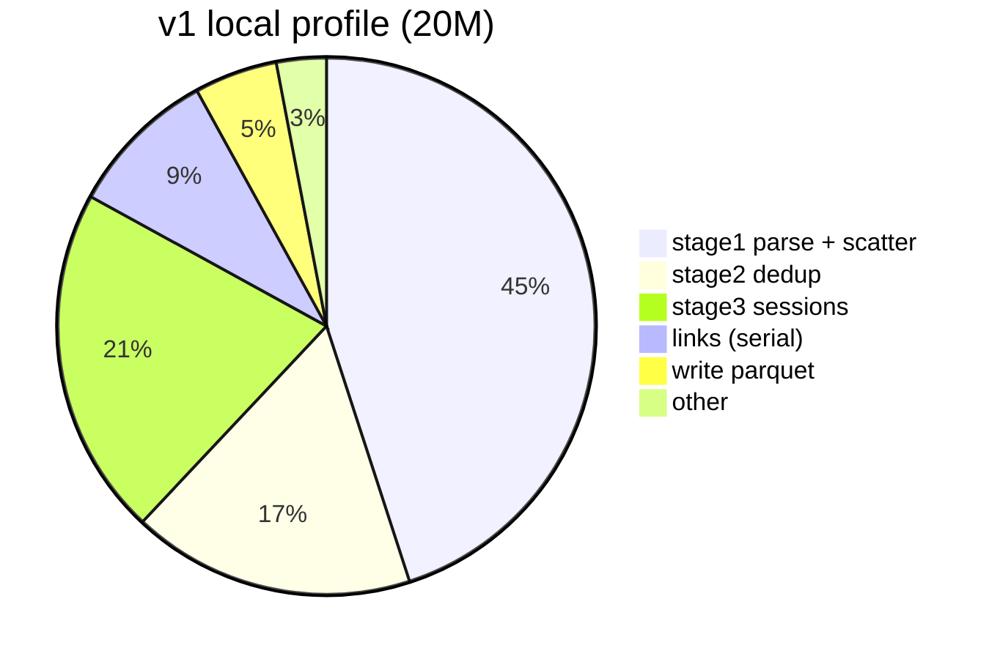
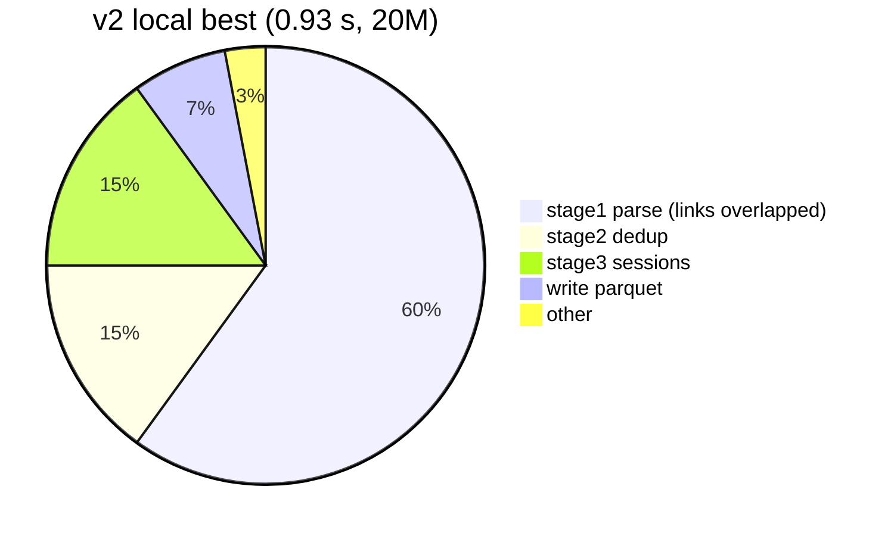
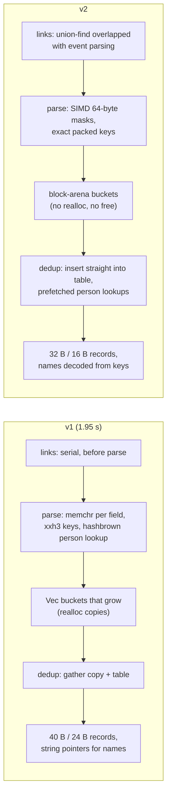
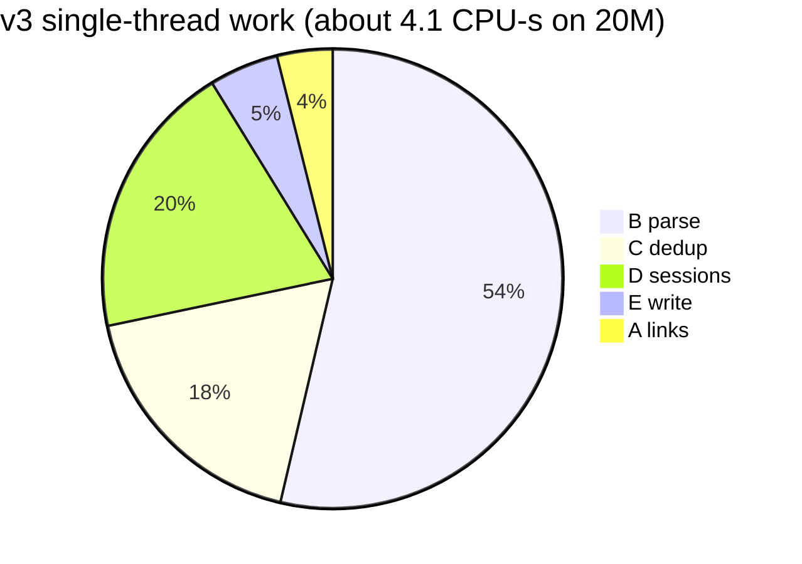
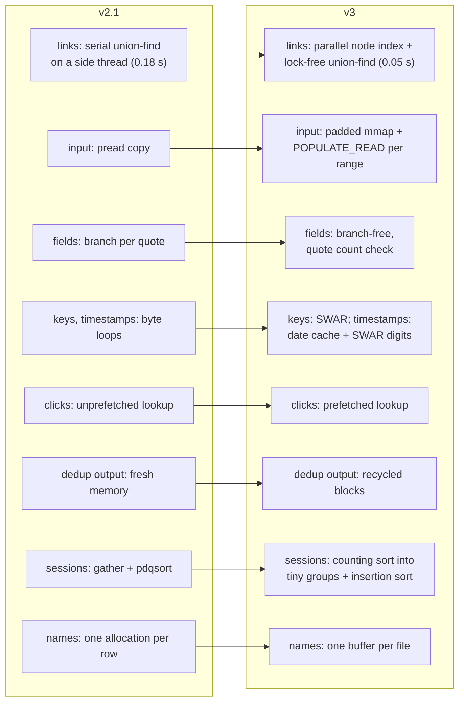

# Progress log

Goal: the top of the Shopping Sessions leaderboard. At the time of the first submission (Sat morning) the fastest practice times were 0.31 s, with the pack around 1.0 to 1.5 s. Final cutoff: Sun 10:00 AM CST.

## Scoreboard

| Version | Commit | Practice score (20M, scorer) | Local best, 20M, data in RAM | Correct |
| --- | --- | --- | --- | --- |
| v1 | `4a02f9d` | **1.95 s** | 1.80 s | 36/36 fixtures, dev MATCH |
| v2 | `88d363d` | not submitted | 0.93 s | 36/36 fixtures + dev MATCH on arm64 and amd64 (AVX2); 20M identical to v1 |
| v2.1 | `451a10f` | not submitted | ~13% faster than v2 in an interleaved A/B | same, plus dev MATCH with 997-byte and 64-byte chunks (boundary stress) |
| v3 | `2402180` | not submitted | **0.80 s** (v2.1: 1.04 s) | unit tests (fast parsers and scanner vs reference), 36/36 fixtures, dev MATCH, boundary stress, on arm64 and amd64; 20M identical to v1 |
| v3.1 | `42e0506` | **1.45 s** | **0.77 s** (v3 in the same A/B: 0.84 s) | unit tests, 36/36 fixtures + dev MATCH on arm64 and amd64; 20M identical to v1 |
| v3.2 | `6f6ed83` | not submitted | single-thread work 3.73 s vs 4.14 s for v3.1 (interleaved, min of 6) | unit tests, fixtures, dev (also 997 / 64-byte ranges) on arm64 and amd64; 20M identical to v1 |
| v3.3 | `341b502` | **1.17 s** (same code again at `d4dc286`: 1.14 s) | exit work after the last stage: best 15 ms vs 57 ms | same suite, both platforms; 20M identical to v1 |
| v3.4 | `5862f0d` | not submitted | same as v3.3 locally; drops `MADV_POPULATE_READ` (slower on the scorer) | full suite, both platforms; 20M identical to v1 |
| v3.5 | see git log | not submitted yet | user_daily writing 0.15 to 0.18 s vs 0.19 to 0.28 s (single thread, 2.24M rows) | full suite, both platforms; 20M identical to v1; files read identically by polars, pyarrow and DuckDB, including empty tables |

Local timings come from a Docker VM on an 8-core Apple-silicon Mac, with the data in `/dev/shm`. The Mac is often loaded, so one run can vary 2 to 3x. Only best-of-N is meaningful, and only the board counts.

## Local vs scorer

| Version | Local best (8 threads) | Board | Board / local |
| --- | --- | --- | --- |
| v1 | 1.80 s | 1.95 s | 1.08 |
| v3.1 | 0.77 s | 1.45 s | 1.9 |
| v3.3 | ~0.70 s | 1.17 s | 1.7 |

Since v1, every local gain has shrunk by roughly half on the board. v1 was dominated by computation. The later versions cut computation, so what remains is mostly memory traffic, page faults and page zeroing, and random lookups into large tables. The Apple-silicon dev Mac hides those costs: it has very high memory bandwidth, large caches, and huge pages on by default in its Linux VM. The scorer is a Cascade Lake VM: 4 cores with hyperthreading, 1 MB L2 per core, and unknown huge-page policy and fault costs. Local tuning was therefore aimed at the wrong machine.

**Diagnostic build** (`diag` branch, `FM_DIAG=1`). The scorer returns logs only when the dev check fails, and a rejected submission never changes the best score. So this build prints scorer facts and measurements, then exits 1:
* CPU, caches, huge-page policy, kernel, mounts
* page-fault, bandwidth, random-access and input-read microbenchmarks
* per-stage user/kernel times for six pipeline runs on a 20x tiled dev set in `/scratch`: 8, 4 and 1 threads, and huge pages on

## What the scorer showed (diagnostic run, Sat ~12:50)

The diagnostic ran on the scorer; its log tail came back. One pipeline run on the 20x tiled dev set, 20M events and 1.8 GB, 8 threads:

| Stage | Wall | CPU (user + sys) |
| --- | --- | --- |
| open, small tables | 0.024 s | |
| links | 0.053 s | 0.34 s |
| stage 1 parse | 0.536 s | 4.24 s (sys 0.61) |
| stage 2 dedup | 0.205 s | 1.63 s |
| stage 3 sessions + user_daily | 0.233 s | 1.83 s |
| campaign table, arena release | 0.033 s | 0.19 s |
| **total** | **1.07 to 1.09 s** | user 7.1 s, sys 1.1 s |

Findings:
* **CPU-bound.** All 8 threads stay busy, and 87% of CPU is our own code. Per thread the scorer does about half the work of one Mac core, so 8 scorer threads are worth about 3.6 Mac cores. Reaching about 0.3 s means about 3.5x less work per line.
* **Input reading is cheap.** Touching 1.65 GB of cached input with 8 threads took 0.02 s with plain page faults (84 GB/s), 0.04 s with `MADV_POPULATE_READ` (44 GB/s) and 0.05 s with `pread` (35 GB/s). v3.4 drops `POPULATE_READ`.
* **Huge pages hurt.** `MADV_HUGEPAGE` on the arena made stage 1 0.62 s instead of 0.54 s.

The scorer shows only the tail of stderr, so the system facts printed first were cut off. A future diagnostic should print its most important lines last.

## v3.5: hand-written Parquet

`out.rs` now writes Parquet itself:
* "PAR1", then per column one or more plain-encoded, uncompressed v1 data pages of up to 128K rows, then a Thrift-compact `FileMetaData`, its length, and "PAR1"
* `day` is INT32 with DATE annotations; strings are BYTE_ARRAY with UTF8/STRING; `top_category` is OPTIONAL with bit-packed definition levels
* 2 of 6 user_daily columns are now INT32 (any integer width is accepted)

This drops the parquet crate and its dependency tree. Checks:
* 20M output is identical to v1 as read by polars, pyarrow and DuckDB.
* Empty tables are valid in all three, and in the starter's fixture loader.

The direct timing shows writing was about 4% of single-thread work, not the 10% an earlier noisy estimate suggested. So this is a small win.

## Where the time goes

v2 profile (perf, CPU samples):
* Stage 1 user code is 47%: the scan loop 22%, event field parsing 17%, click parsing 8%.
* The kernel takes about 25%: page zeroing 8%, page-allocator lock contention 6%, page migration 4.5%.
* Stage 2 is 9%, and the stage 3 sort and walk 8%.

## v1 -> v2: what changed and why

## v3: single-thread cost per stage (20M events, data in RAM)

With one worker, the stages run back to back, so each stage's CPU cost is measurable without the noise of the loaded Mac. 8-thread wall time is roughly this divided by 5, because the Mac has 4 performance and 4 efficiency cores; the scorer's 4 cores with hyperthreading scale similarly.

| Stage | Work | Main costs |
| --- | --- | --- |
| A links | 0.16 s | parse, node index, union-find (all parallel in v3) |
| B parse | 2.2 s | page mapping or copying of input ~0.5, SIMD scan + fields ~0.5, field parsing ~0.6, record pushes (fresh memory) ~0.5, clicks ~0.25 |
| C dedup | 0.74 s | table 0.31, person lookups 0.33, pushes 0.10 |
| D sessions | 0.8 s | grouping 0.1, tiny sorts 0.3, session walk 0.4 |
| E write | 0.2 s | |

## v2.1 -> v3

## Measurements behind v2.1

Single-thread scanner throughput on memory that is already touched, on one 256 MB event file (best of 5):

| Step | Throughput |
| --- | --- |
| SIMD masks only | 17 GB/s |
| + cut lines and fields | 2.1 GB/s |
| + two ID keys | 1.55 GB/s |
| + two timestamps | 1.2 to 1.4 GB/s |
| (memchr for newlines, reference) | 29 to 35 GB/s |

Inside the pipeline, the same field-splitting step ran at about half that speed. The difference was first-touch page faults on the `mmap`ed input. Hence the switch to `pread`.

## Experiments

| Idea | Result | Kept? |
| --- | --- | --- |
| Block arena instead of growing `Vec` buckets | Less copying and memory churn; parse no longer dominated by reallocation | yes |
| Single-pass SWAR line splitter vs memchr per field | 0.047 s vs 0.056 s per 64 MB (single thread) | superseded by the SIMD scanner |
| `MADV_POPULATE_READ` per input chunk | No measurable change | no |
| Huge pages on the arena (`MADV_HUGEPAGE`) | No change locally, because the VM's THP is already `always`. Scorer setting unknown | env switch `FM_THP`, off |
| Exact packed ID keys | Removes hashing, string pointers and collision risk | yes |
| Union-find on its own thread | Takes about 0.18 s of serial work off the critical path | yes |
| 16-byte person records | Halves stage 3 traffic | yes |
| `pread` ranges into reused buffers instead of `mmap` | ~13% faster end to end in an interleaved A/B; stage 1 no longer pays input page faults | yes |
| Fast path in field split for quote-free lines | Only 21% of lines have no quote (0.8^7), so little gain | replaced by branch-free check in v3 |
| v3 parallel links | 4.4 s at first: the per-partition tables took slot bits from the same hash bits as the partition, so keys piled into 1/64 of each table. Fixed by rotating the hash: 55 ms | yes |
| v3 padded `mmap` + `POPULATE_READ` instead of `pread` | Same single-thread work here (tmpfs), but less memory traffic: best 8-thread run 0.80 s vs 0.97 s | yes |
| `MAP_POPULATE`, `MADV_HUGEPAGE`, `MADV_NOHUGEPAGE` on the arena | No difference beyond noise (single thread, 3 rounds) | no |

## v3 -> v3.1

* A blocked Bloom filter in each link-map partition (2 bits per key in one u64, about 2 bytes per linked id) answers most "not linked" lookups from cache. Prefetches are skipped for ids it rules out.
* In stage 3, a group holding one person, which is the usual case, is sorted by time alone.
* Each worker writes its user_daily file as soon as its buckets are done, so writing overlaps with other workers' sessionizing.
* The process exits without running destructors.

Measured single-thread splits behind these choices (minimum of 7 runs, 20M):

| Experiment | Stage 1 |
| --- | --- |
| normal | 1.91 s |
| no `POPULATE_READ` (plain page faults) | 1.91 s |
| records pushed to a 64 KB scratch ring instead of buckets | 1.54 s |

So bucket pushes, which write fresh memory, cost about 0.37 s of single-thread work. Pre-faulting the input changes nothing. With 256, 1024 or 4096 event buckets, stage 1 and stage 2 change by about 0.1 s at most.

## v3.1 -> v3.2

A steady single-thread microbenchmark (`BENCH=1`) runs each parsing layer over one warm 256 MB event file, best of 5, and varies by about 3% between runs. It replaced end-to-end timings for tuning:

| Layer, per event line | v3.1 | v3.2 |
| --- | --- | --- |
| SIMD scan + field split | 21.9 ns | 21.9 ns |
| + both ID keys | +12.6 ns | +6.3 ns |
| + both timestamps | +15.2 ns | +15.2 ns |
| all of `parse_event` | 48.9 ns | 42.4 ns |
| + push into 1024 buckets | +14 ns | +9 to 10 ns |

* **ID keys:** generator IDs are one known letter plus at most 8 ASCII bytes, so those bytes, big-endian, are an exact key that also sorts in byte order. That takes one load and a few checks, against 6-bit packing. Anything else still gets the hashed key.
* **Push:** pushing into many buckets missed the cache on almost every store. With 64 buckets the push is 5.5 ns; with 4096 it is 20 to 29 ns, the same with fresh or recycled memory. Software write-combining fixes this. Each bucket fills one cache line in a small buffer, and full lines are written with non-temporal stores (`vmovntdq` on the scorer, `stnp` on ARM). This applies to stage 1 events and stage 2 output.
* **Day numbers:** a division per session was replaced by a precomputed day offset.

Instruction-level profile (`perf annotate`, single thread) after these changes:
* About 40% of the scan loop is the 64-byte input loads: streaming the input from memory.
* The kernel zeroing fresh pages (`dc zva`) is about 10% of all work.
* Stage 2 waits on person lookups and on the dedup table.

Tried and dropped (single-thread minimums, 4 runs each):

| Idea | Result |
| --- | --- |
| Software prefetch 512 B to 4 KB ahead in the scanner | slower: stage 1 2.2 s vs 1.96 s without |
| Prefetch dedup table slots and the record stream 8 ahead | no change |
| Person-lookup prefetch distance 8 / 16 / 32 / 64 | no change (kept 32) |

## v3.2 -> v3.3: teardown

The clock runs until the container exits, and exiting is not free. Measured from the end of stage 3 to process exit (20M, 8 threads): 60 to 100 ms, about 9% of a run. Most of it is the kernel tearing down, on one thread:
* about 1 GB of arena memory
* the page mappings of 1.8 GB of input

Write-ups from the One Billion Row Challenge note the same effect: unmapping cost is charged to wall-clock time. v3.3 moves that work into the parallel stages:
* Each stage 1 worker drops the page mappings of a range right after parsing it (`MADV_DONTNEED`). The pages stay in the page cache.
* After stage 3, all workers give the arena back together (`MADV_DONTNEED` in 64 MB pieces).

The local A/B is noisy. The best case went from 57 ms to 15 ms; on theory the change only moves serial work into parallel work.

## Scale check (40M events, seed 11)

* Runs end to end. Sessions and revenue sums match across the two tables, assists cover credited sessions, and there are no duplicate keys.
* Process memory is about 3 GB; the 6.4 to 6.7 GB cgroup peak includes the 3.6 GB input in page cache. That points to about 4.5 GB at 60M, well under 24 GB.

## Backlog (ordered by expected gain)

1. 16-byte dedup records instead of 32: take the bucket from the eid's own bits, store a 17-bit `ingest - ts` instead of `ingest`, keep purchase price and category in a side stream. This halves stage 1 writes, stage 2 reads and kernel page zeroing.
2. Timestamps (15 ns per line): wider SIMD for the fixed F1 layout.
3. Calibrate everything against a real board score: local runs mix performance and efficiency cores and a loaded host.
4. Tune bucket counts and range size for 60M; check whether more threads than `NCPU` helps on the scorer.
