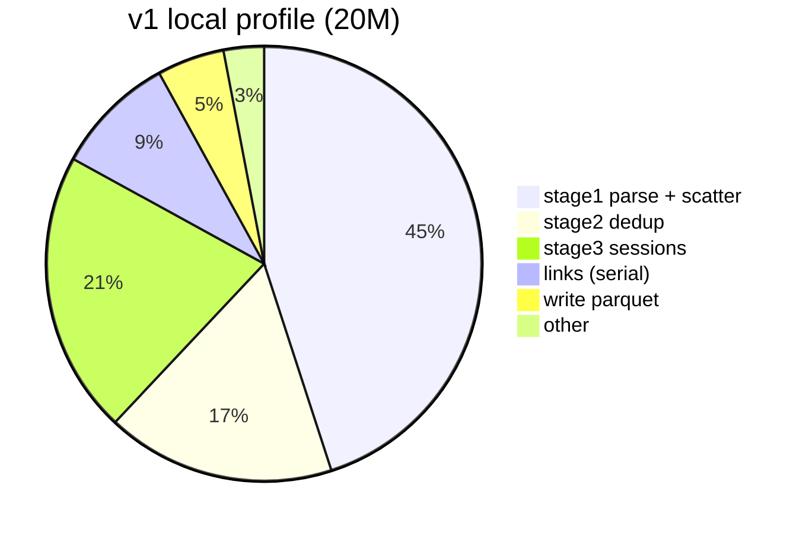
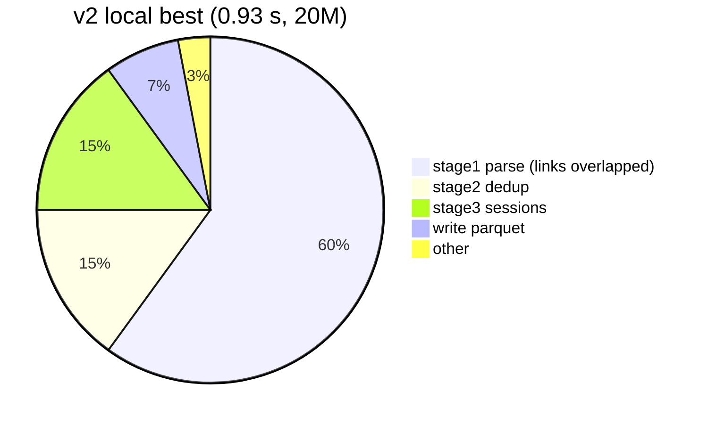
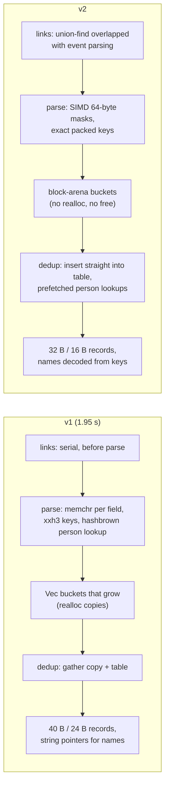
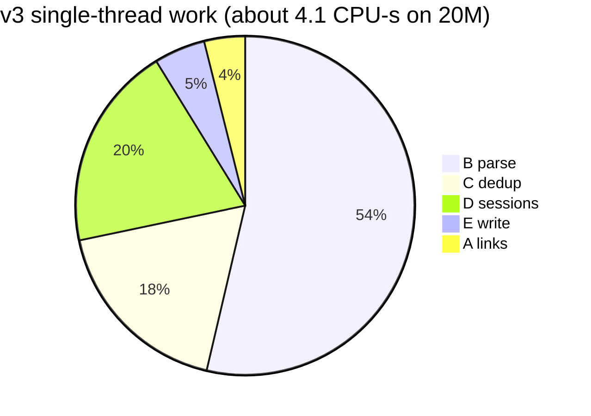
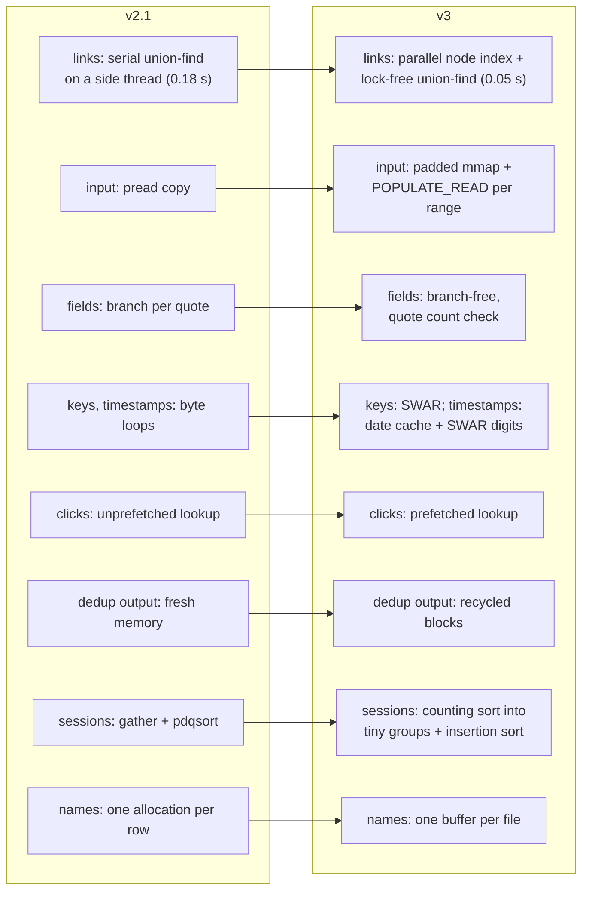

# Progress log

Goal: the top of the Shopping Sessions leaderboard. At the time of the first submission (Sat morning) the fastest practice times were 0.31 s, with the pack around 1.0 to 1.5 s. Final cutoff: Sun 10:00 AM CST.

## Scoreboard

| Version | Commit | Practice score (20M, scorer) | Local best, 20M, data in RAM | Correct |
| --- | --- | --- | --- | --- |
| v1 | `4a02f9d` | **1.95 s** | 1.80 s | 36/36 fixtures, dev MATCH |
| v2 | `88d363d` | not submitted | 0.93 s | 36/36 fixtures + dev MATCH on arm64 and amd64 (AVX2); 20M identical to v1 |
| v2.1 | `451a10f` | not submitted | ~13% faster than v2 in an interleaved A/B | same, plus dev MATCH with 997-byte and 64-byte chunks (boundary stress) |
| v3 | see git log | not submitted yet | **0.80 s** (v2.1: 1.04 s) | unit tests (fast parsers and scanner vs reference), 36/36 fixtures, dev MATCH, boundary stress, on arm64 and amd64; 20M identical to v1 |

Local timings come from a Docker VM on an 8-core Apple-silicon Mac, with the data in `/dev/shm`. The Mac is often loaded, so one run can vary 2 to 3x. Only best-of-N is meaningful, and only the board counts.

## Where the time goes

v2 profile (perf, CPU samples):
* Stage 1 user code is 47%: the scan loop 22%, event field parsing 17%, click parsing 8%.
* The kernel takes about 25%: page zeroing 8%, page-allocator lock contention 6%, page migration 4.5%.
* Stage 2 is 9%, and the stage 3 sort and walk 8%.

## v1 -> v2: what changed and why

## v3: single-thread cost per stage (20M events, data in RAM)

With one worker, the stages run back to back, so each stage's CPU cost is measurable without the noise of the loaded Mac. 8-thread wall time is roughly this divided by 5, because the Mac has 4 performance and 4 efficiency cores; the scorer's 4 cores with hyperthreading scale similarly.

| Stage | Work | Main costs |
| --- | --- | --- |
| A links | 0.16 s | parse, node index, union-find (all parallel in v3) |
| B parse | 2.2 s | page mapping or copying of input ~0.5, SIMD scan + fields ~0.5, field parsing ~0.6, record pushes (fresh memory) ~0.5, clicks ~0.25 |
| C dedup | 0.74 s | table 0.31, person lookups 0.33, pushes 0.10 |
| D sessions | 0.8 s | grouping 0.1, tiny sorts 0.3, session walk 0.4 |
| E write | 0.2 s | |

## v2.1 -> v3

## Measurements behind v2.1

Single-thread scanner throughput on memory that is already touched, on one 256 MB event file (best of 5):

| Step | Throughput |
| --- | --- |
| SIMD masks only | 17 GB/s |
| + cut lines and fields | 2.1 GB/s |
| + two ID keys | 1.55 GB/s |
| + two timestamps | 1.2 to 1.4 GB/s |
| (memchr for newlines, reference) | 29 to 35 GB/s |

Inside the pipeline, the same field-splitting step ran at about half that speed. The difference was first-touch page faults on the `mmap`ed input. Hence the switch to `pread`.

## Experiments

| Idea | Result | Kept? |
| --- | --- | --- |
| Block arena instead of growing `Vec` buckets | Less copying and memory churn; parse no longer dominated by reallocation | yes |
| Single-pass SWAR line splitter vs memchr per field | 0.047 s vs 0.056 s per 64 MB (single thread) | superseded by the SIMD scanner |
| `MADV_POPULATE_READ` per input chunk | No measurable change | no |
| Huge pages on the arena (`MADV_HUGEPAGE`) | No change locally, because the VM's THP is already `always`. Scorer setting unknown | env switch `FM_THP`, off |
| Exact packed ID keys | Removes hashing, string pointers and collision risk | yes |
| Union-find on its own thread | Takes about 0.18 s of serial work off the critical path | yes |
| 16-byte person records | Halves stage 3 traffic | yes |
| `pread` ranges into reused buffers instead of `mmap` | ~13% faster end to end in an interleaved A/B; stage 1 no longer pays input page faults | yes |
| Fast path in field split for quote-free lines | Only 21% of lines have no quote (0.8^7), so little gain | replaced by branch-free check in v3 |
| v3 parallel links | 4.4 s at first: the per-partition tables took slot bits from the same hash bits as the partition, so keys piled into 1/64 of each table. Fixed by rotating the hash: 55 ms | yes |
| v3 padded `mmap` + `POPULATE_READ` instead of `pread` | Same single-thread work here (tmpfs), but less memory traffic: best 8-thread run 0.80 s vs 0.97 s | yes |
| `MAP_POPULATE`, `MADV_HUGEPAGE`, `MADV_NOHUGEPAGE` on the arena | No difference beyond noise (single thread, 3 rounds) | no |

## Backlog (ordered by expected gain)

1. Stage 2 person lookups (0.33 s): an in-cache filter of linked IDs in front of the 32 MB map would skip most cache misses.
2. Stage 3 tiny sorts (0.3 s): sort by ts alone when a group holds one person.
3. Stage 1 field parsing (0.6 s) and record pushes (0.5 s).
4. Tune bucket counts and range size for 60M; check whether more threads than `NCPU` helps on the scorer.
